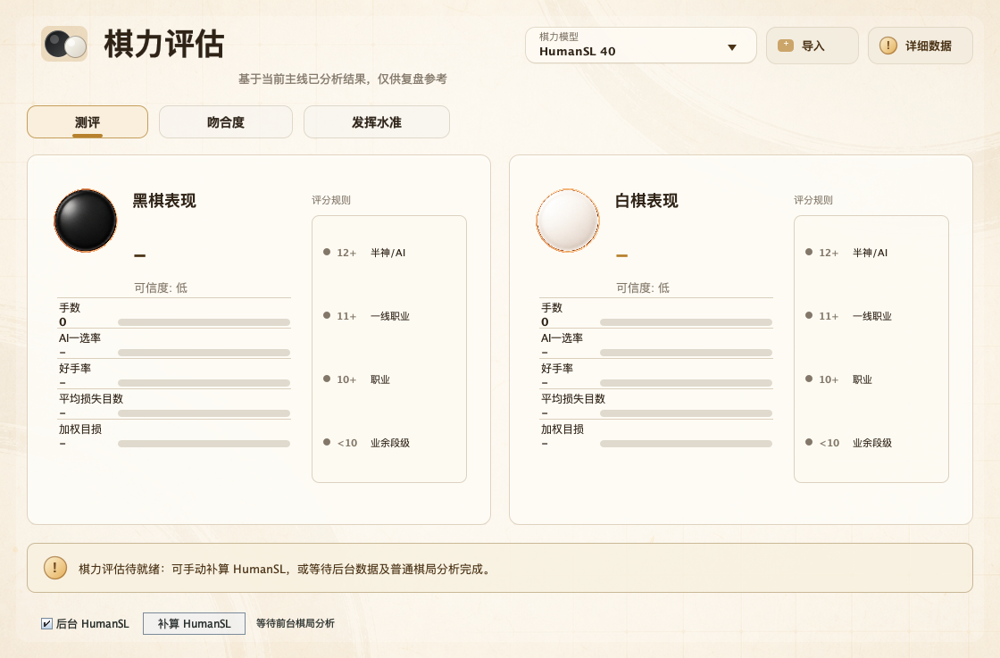

# HumanSL 40 strength assessment

## Current Workflow

Open a normally analyzed SGF and select **HumanSL 40** in the existing
player-strength model dropdown. Both player estimates, matching statistics,
performance charts, and detailed data remain in the original dashboard.
`xgboost20tun` remains the default; the separate HumanSL game mode is unchanged.
The retired **XGBoost 20TUN Previous** entry and its bundled booster/calibrator
have been removed; the current 20TUN model and imported models are unchanged.



This UI screenshot uses a synthetic demonstration game and synthetic cached
ordinary analysis, not a private game or model-accuracy benchmark.

Selecting the model **never starts an engine, download prompt or progress dialog**.
Use **Run HumanSL supplement** to explicitly open progress and prepare missing
data. Completed background data are displayed without a progress window.
The **Background HumanSL** checkbox is off by default and persisted per profile;
enable it explicitly if spare local GPU capacity is available.
While ordinary foreground pondering or game analysis is active, the background
queue silently prefetches all main-line HumanSL policies, including moves after
210. The 40-feature estimator still uses only the first 210 moves and current
ordinary analysis; prefetching a whole game does not change that model contract.

Background work uses at most four concurrent positions, each with a single
search thread, enabling KataGo cross-position batching. It does not load an
ordinary judge or repeat ordinary searches. Manual and background work share a
single-owner queue: manual work retires the background attempt, waits for its
worker to close, then resumes missing cache entries. Changing games/rules,
disabling the checkbox, pausing ordinary analysis, entering a reserved game or
engine task, or closing the app cancels
background work and retains completed private cache entries. Turning background
off does not cancel an explicitly requested manual job. Normal foreground
completion permits an already-started background batch to finish. A failed
attempt is not retried every UI tick; manual retry or re-enabling the checkbox
re-arms it. Background failures and missing weights are status-only: download
confirmation occurs only through the explicit button. Enabling this option
does not guarantee that two GPU workloads have zero contention.

There is no judge selection, model-path form, separate assessment table, or
second ordinary whole-game analysis. The assessment captures the current
primary analysis on the main line, capped at the first 210 moves, including
candidate order/prior/score, root score and winrate. Scores are normalized to
side-to-move perspective. Current analysis rules and normalized game komi are
reused, not reinterpreted from raw SGF properties. Each side needs at least six
valid moves with candidates before the move and root estimates on both sides
of the move. Missing positions are skipped, never automatically searched.
Handicap, setup/edit, nonalternating histories and non-19x19 games are not yet
validated and are rejected.

Only missing HumanSL policies are obtained from a supplementary local process.
Every profile (1d, 5d, 9d) uses **maxVisits=1**, history enabled, two root
symmetries, and zero weightless human exploration. The last post-move position
needs no human policy. The supplemental process's scores, winrates and
candidates are discarded. It cannot publish into board analysis or change the
normal engine/configuration. Cancel, close or Escape in the explicit progress
dialog stops its manual job; closing the dashboard leaves background work alone. A
game/history/rules change invalidates the captured result.

The local KataGo executable and HumanSL weight are discovered automatically.
If the weight is missing, the manual button asks to download it (about 99 MB) via the
existing validated downloader, which supports cancellation. No standard judge
network is needed: the supplement uses the verified human network itself as
its main network. A missing local executable is reported with the existing
engine setup/download route, rather than asking for an analysis command here.

## Model And Features

The bundled teacher-label XGBoost booster has 40 features and was fitted on 105
Zhangqi games / 210 sides. It does not attach `xgboost20tun`'s residual
calibrator, soft gate, heuristic tail-loss rank cap, or legacy uncertainty.
Predictions are bounded to [0,12]. The historical teacher cohort has only seven
sides below 5d: low-rank and long-term player strength are not validated.

Features comprise 20 standard matching/loss/difficulty/phase features, 8 robust
loss/extreme-position features, and 12 HumanSL surprisal/difficulty/coverage
features across the three profiles. Strict first choice, feature ordering,
training rounding, phase fallback, and acceptable-loss thresholds are retained.
Coverage below 90% leaves that position's HumanSL difficulty missing, not zero.
The detail view's **HumanSL 9d difficulty** is the percentage average over
reliably covered positions; **coverage** is mean searched human probability
mass, not a confidence interval or tactical correctness guarantee. An absent
reliable difficulty displays `-`. Segment reports use the same enriched move
records and 40-feature scorer, with at least six samples per segment.

### Training Versus Reused Analysis

Reference training used KataGo 1.18.2 and
`kata1-b18c384nbt-s9996604416-d4316597426.bin.gz`, with a 5d/maxVisits=500
base query and 50% weightless human exploration. Separate 1d/9d policy probes
used one visit. The production workflow now deliberately reuses the user's
current ordinary analysis instead of enforcing or rerunning that judge search.
Different engines, visits, candidate breadth and evaluation biases can change
the features. In particular, ordinary search may cover less human probability
mass, making more difficulty values missing. Consequently reference-case
predictions/validation accuracy cannot be promised for arbitrary reused
analysis. The dashboard identifies the estimate as experimental.

Human network: `b18c384nbt-humanv0.bin.gz`, SHA256
`637746e44f0efe00ad1245a50aa9bbf0716efe364c43965ead97bd6835d84ab5`.
The weights are verified before inference. The small Java booster is bundled;
the large public HumanSL network is not bundled.

## Cache And Privacy

Policies and logs live in `~/.lizzie/strength-humansl40-policy-cache`, outside
Git. Policy keys include canonical history, rules, komi, initial player,
profile, all query controls, recipe version, executable/config hash and human
network hash. Only complete normalized policy data are cached. Error, warning,
partial and invalid responses are rejected. Cached policies can be reused when
ordinary analysis improves; predictions and coverage are always recomputed
from the newly captured candidates. A complete cache replay does not start an
engine. Raw SGFs, labels, fixtures, screenshots and query results are not
resources and remain outside Git or in ignored `target/` directories. This
feature performs no uploads or Git operations.

## Verification

```sh
mvn -Dfmt.skip -Dtest='*Strength*Test,HumanSlAnalysisRunnerTest,AnalysisRequestBuilderTest' test
```

`HumanSlStrengthReuseSessionTest` covers policy-only budgets, zero ordinary
queries, cache reuse and komi isolation, missing-position skipping, unchanged
analysis, perspective conversion, cancellation, invalid responses, dropdown
availability, and model consistency in reports/segments. The optional
`HumanSlStrengthReuseLiveProbe` entry point runs the real local engine on a
private 12-move fixture, verifies 36 one-visit policy queries, untouched ordinary
analysis, exact cache replay without an engine, and shutdown.
`HumanSlStrengthGuiProbe` opens the actual application with an isolated profile,
selects the original dropdown, checks the original dashboard/details and absence
of path fields, and captures screenshots. These are plumbing tests, not a
12-move skill accuracy evaluation.

The retained `HumanSlStrengthSession` and `HumanSlStrengthLiveProbe` are
developer-only reference-recipe checks, not used by the dashboard. Private
full-game fixtures can be checked with
`-Dlizzie.strength.humansl40.fixture=/absolute/path/to/fixture.json`. Four cached
reference predictions matched Python to 2e-5 and feature vectors to 1e-9:
10.40684, 9.09523, 9.82226, 11.45424. This confirms reference inference parity,
not fresh-search determinism or accuracy under arbitrary reused analysis.

Protocol reference: [KataGo Human SL analysis guide](https://github.com/lightvector/KataGo/blob/master/docs/Analysis_Engine.md#human-sl-analysis-guide).
